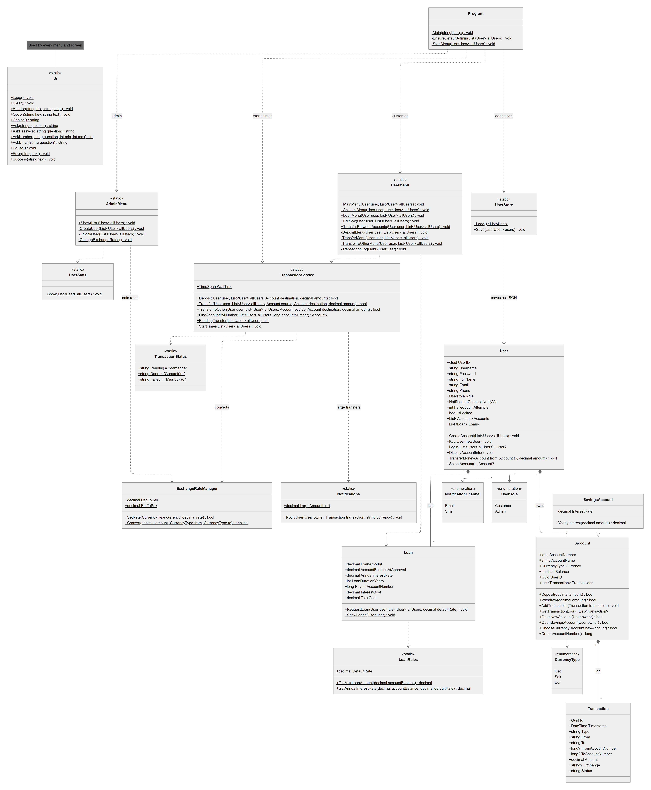

# Bankapp

A small C# console application that simulates basic banking workflows. The application supports customer registration and login, accounts in SEK, USD and EUR, savings accounts, deposits, transfers with currency conversion, pending transfers, loans, notifications for large transactions, and administrator tools for users, exchange rates and statistics. It is intended as a learning project.

## Development Plan

We worked in two sprints in Jira (project BANK). Tickets were built on their own branches and merged into `main` through pull requests with code review.

### Sprint 1 (14 Oct – 27 Oct 2026)

Goal: Register, log in, open accounts in SEK/USD/EUR, see balances and the transaction log.

| Ticket | Task | Owner |
| --- | --- | --- |
| BANK-5 | Set up solution, folders and class skeleton | Shubham |
| BANK-6 | Implement user registration and login with unique username and password | Tony |
| BANK-7 | Lock users out after three failed login attempts | Tony |
| BANK-8 | Allow customers to open new bank accounts | Alexander |
| BANK-9 | Support accounts in SEK, USD or EUR | Alexander |
| BANK-10 | Display list of customer's accounts and balances | Sima |
| BANK-13 | Enable admins to create and unlock users | Tony |
| BANK-16 | Add savings accounts with interest preview on deposit | Alexander |
| BANK-21 | Allow users to update email and phone number | Tony |

### Sprint 2 (27 Oct – 10 Nov 2026)

Goal: Money moves: transfers, admin creates users, savings.

| Ticket | Task | Owner |
| --- | --- | --- |
| BANK-11 | Add deposits and a transaction log per account | Tony |
| BANK-12 | Design consistent menus, colors and ASCII-art logo | Shubham |
| BANK-14 | Transfer money between own accounts | Sima |
| BANK-15 | Transfer money to other customers' accounts | Sima |
| BANK-17 | Convert cross-currency transfers using admin-managed exchange rates | Sima |
| BANK-18 | Allow customers to take loans with interest preview | Tony |
| BANK-19 | Limit total loans to 5x customer's bank holdings | Tony |
| BANK-20 | Process pending transfers in 15-minute batches | Alexander |
| BANK-22 | Show transaction statistics in admin menu | Alexander |
| BANK-23 | Write notifications for large transactions | Alexander |
| BANK-24 | Let admins set loan interest rate rules | Tony |

## Source Code Structure

The code is organized by responsibility in C# classes. The main menu classes handle console interaction, while model classes represent banking data and service or utility classes provide shared operations.

| Class or type | Responsibility |
| --- | --- |
| `Program` | Application entry point. Loads saved users, ensures an administrator account exists, starts transaction processing, and routes signed-in users to the correct menu. |
| `User` | Represents a customer or administrator. Holds profile details, accounts, loans, role, and login lockout state. Also contains registration, KYC, login, and account-selection behavior. |
| `UserRole` | Enum that distinguishes customer and administrator users. |
| `UserMenu` | Customer-facing console menus for profile details, accounts, deposits, transfers, transaction history, and loans. |
| `AdminMenu` | Administrator-facing console menu for creating users, unlocking accounts, changing exchange rates, and viewing user statistics. |
| `Account` | Represents a bank account and provides account operations such as opening accounts, deposits, withdrawals, and transaction-log access. |
| `SavingsAccount` | Specialized account type that adds savings-interest information and calculations. |
| `CurrencyType` | Enum for the currencies supported by accounts and currency conversion. |
| `NotificationChannel` | Enum describing how a user prefers to receive notifications. |
| `Notifications` | Sends a simulated e-mail or SMS (`NotificationChannel`) when a transfer over 10 000 is completed and logs it to `notifications.txt`. |
| `Transaction` | Records transaction details such as type, source, destination, amount, timestamp, and status. |
| `TransactionStatus` | Constants for a transfer's status: `Väntande` (pending), `Genomförd` (done), `Misslyckad` (failed). |
| `TransactionService` | Coordinates deposits and transfers, including transfers between customers and the timed processing flow. |
| `ExchangeRateManager` | Holds the USD and EUR rates set by the administrator, saves them to `rates.txt`, and converts amounts between currencies. |
| `Loan` | Represents a loan and handles loan applications, payout to an account, and displaying a user's loans and estimated costs. |
| `LoanRules` | Contains loan policy calculations, including the maximum loan amount and annual interest-rate tiers. |
| `UserStore` | Loads and saves the user list as JSON so that data remains available between application runs. |
| `UserStats` | Shows transaction statistics for the administrator: counts by type and status, total transferred per currency, and the most used accounts. |
| `Ui` | Shared console helpers for prompts, menus, input validation, status messages, and screen formatting. |

## Main Objects and Relationships

- A `User` has a role, profile details, a list of `Account` objects, and a list of `Loan` objects.
- `SavingsAccount` extends the general `Account` behavior with savings interest.
- An `Account` keeps its transaction history as `Transaction` objects.
- `UserMenu` and `AdminMenu` collect choices from the console and call the relevant classes and services.
- `Loan` uses `LoanRules` to determine loan limits and interest rates.
- `TransactionService` uses `ExchangeRateManager` when an operation involves different currencies.
- `TransactionService` calls `Notifications` when a completed transfer is over 10 000.
- `AdminMenu` uses `ExchangeRateManager` to change rates and `UserStats` to show statistics.
- `Program` loads the users with `UserStore` at startup; the menus, `TransactionService`, `Loan` and `User` call `UserStore.Save` after every change.

## UML



## Typical Application Flow

1. `Program` loads users from `UserStore` and shows the start menu.
2. A new customer can register through `User.CreateAccount()`, which collects KYC details and creates an initial account.
3. A signed-in customer is sent to `UserMenu`; an administrator is sent to `AdminMenu`.
4. Menu actions call account, transaction, currency, or loan functionality.
5. Changes are saved by `UserStore` as JSON.

## Running the Application

With the .NET 10 SDK installed, open a terminal in the project directory and run:

```bash
dotnet run
```

A default administrator account is created on first start: username `admin`, password `admin`.

The application saves its data next to the executable: `users.json` (users and accounts), `rates.txt` (exchange rates) and `notifications.txt` (sent notifications).

Transfers stay pending for 1 minute by default. Set the environment variable `TRANSFER_WAIT_TIME` (in minutes) to change it, e.g. `0,1` on a Swedish system.

This project is a console-based learning example and is not intended for handling real financial data.
